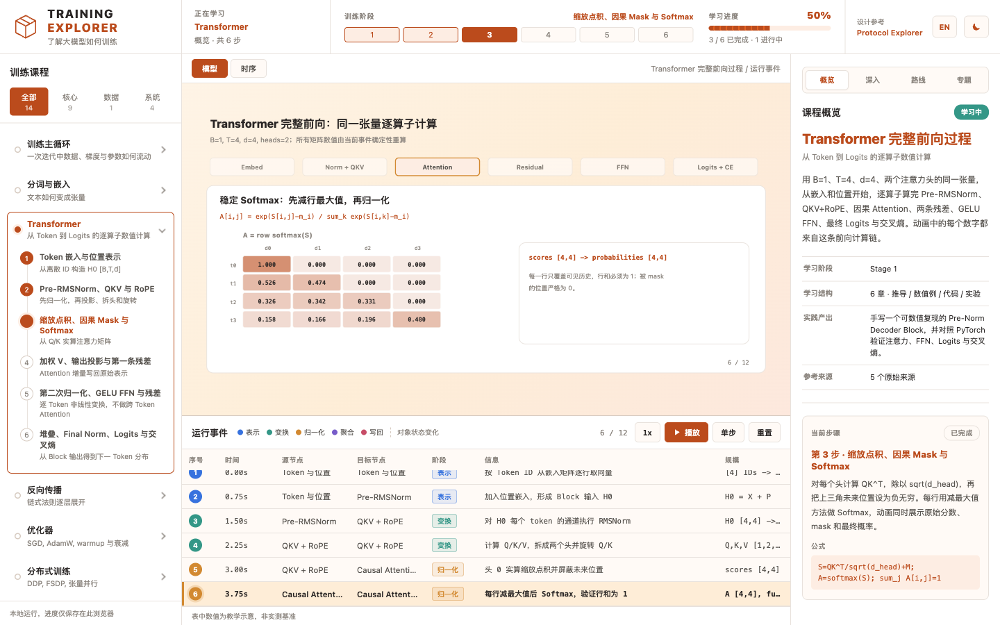
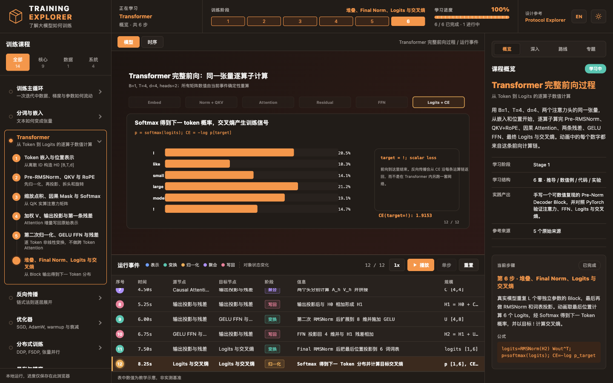

<div align="center">

# TRAINING EXPLORER

**把大模型训练过程变成可以播放、单步和逐项核对的学习实验。**

不是术语卡片，也不是让图标沿连线移动。直接观察 Token、矩阵、注意力权重、残差、FFN、Logits 和损失怎样变化。

[快速开始](#快速开始) · [课程内容](#课程内容) · [Transformer 数值实验](#transformer-数值实验) · [实现原理](#实现原理) · [开发验证](#开发验证)



</div>

## 为什么做这个

学习 Transformer 时，最常见的困难不是缺少公式，而是公式、代码和张量状态彼此分离：

- `softmax(QK^T / sqrt(d))V` 写出来很短，实际经过哪些形状和数值变换并不直观。
- 架构图能说明模块名称，却不能回答某个 Token 此刻能看见谁、贡献了多少权重。
- 代码可以运行，但张量一旦变成 `[B,h,T,d_head]`，仅靠阅读很难发现维度、Mask 或残差连接错误。
- 只讲 API 很容易让学习者误以为 Transformer 就是 Attention，忽略归一化、FFN、残差和训练目标。

Training Explorer 把这些内容放进同一个工作区：左侧组织课程，中间播放模型内部状态，右侧展开推导、数值例、代码、实验和原始资料。

## 你现在可以做什么

- **播放或单步执行**：逐事件观察模型内部计算，支持暂停、后退、跳转和重置。
- **检查真实数值**：Transformer 示例中的矩阵和概率由同一份输入实时计算，不使用随机热图代替计算。
- **跟随张量形状**：从 `[B,T]` 一直跟踪到 `[B,T,V]`，明确每次投影、拆头和归一化发生在哪个维度。
- **阅读深入内容**：每章包含数学推导、具体数值例、Python/PyTorch 实现、进阶实验、常见错误和自测。
- **切换语言与主题**：支持简体中文、英文、浅色和深色模式。
- **查看事件表与时序**：把动画帧对应到来源、目标、操作、说明和张量规模。
- **本地保存进度**：课程、语言、主题和完成状态保存在浏览器本地，不需要账号或后端服务。

## Transformer 数值实验

当前 Transformer 样板课使用一组可手算的缩小配置：

```text
Batch = 1
Tokens = 4
Model dimension = 4
Attention heads = 2
Head dimension = 2
FFN hidden dimension = 8
Output vocabulary = 6
```

同一份输入依次经过 6 章、12 个计算事件：

| 阶段 | 实际展示 | 可以核对什么 |
| --- | --- | --- |
| Token 与位置 | ID 查表、嵌入矩阵 X、位置矩阵 P | `H0 = X + P` 是否逐元素成立 |
| Pre-RMSNorm | 每个 Token 的通道归一化 | 是否沿最后的 `d` 维计算，而非跨 Token |
| QKV + RoPE | Q/K/V 数值、两个头、位置旋转 | RoPE 是否只作用于 Q/K，形状是否为 `[B,h,T,d_head]` |
| Causal Attention | 缩放点积、上三角 Mask、逐行 Softmax | 未来位置是否严格为零，每行概率和是否为 1 |
| 输出与残差 | 两头 AV、拼接、输出投影 | `H1 = H0 + C Wo` 是否保留原始表示通路 |
| GELU FFN | `[4,4] -> [4,8] -> [4,4]` | FFN 是否逐 Token 独立计算，第二次残差是否使用 H1 |
| Final Norm 与输出 | 词表 Logits、下一 Token 概率、CE | Logits 与概率是否区分，CE 是否等于 `-log p_target` |

这些数字都是真实的前向计算结果，但为了可读性采用了教学规模。它们用于理解数学与形状，不代表实际生产模型的参数量、性能或输出质量。

<div align="center">

</div>

## 课程内容

目前包含 14 门可交互课程，覆盖从模型前向到训练系统、推理服务和 Agent 工程的学习路径。

| 阶段 | 课程 | 核心问题 |
| --- | --- | --- |
| 总览 | 训练主循环 | 数据、前向、损失、反向和参数更新怎样组成一次迭代 |
| 基础 | 分词与嵌入 | 文本怎样变成 Token ID 和连续向量 |
| 基础 | Transformer 完整前向过程 | 从 Token 到 Logits 的逐算子数值计算 |
| 训练 | 反向传播与梯度 | 链式法则、计算图、数值梯度和异常定位 |
| 训练 | 优化器与学习率 | SGD、AdamW、Warmup、衰减和超参实验 |
| 系统 | 分布式训练 | DDP、FSDP、TP、PP 与 NCCL 通信 |
| 系统 | 混合精度与显存 | 参数、梯度、优化器、激活、重算与 Offload |
| 系统 | 推理系统与 KV 缓存 | Prefill、Decode、连续批和推测解码 |
| 系统 | AI Infra 量化分析 | 容量、FLOPs、流量、Roofline、MFU 和 MBU |
| 对齐 | 微调与对齐 | SFT、DPO、RLHF、GRPO 与独立评测 |
| 诊断 | 训练调试与诊断 | 小批量过拟合、Loss Spike、NaN 和分层梯度 |
| Agent | 最小 Agent Loop | 状态、工具调用、观察回灌和有界终止 |
| Agent | Agent Harness 工程 | 工具注册、权限、上下文、Trace 和恢复 |
| 评估 | 评测、可观测性与安全 | 独立评分、失败归因、对抗测试和发布回归 |

每门课程都以原始论文、官方文档或源码资料作为参考入口，而不是只给出没有出处的二手结论。

## 快速开始

需要 Node.js 18 或更新版本。

```bash
git clone <repository-url>
cd training-explore
npm install
npm run dev
```

打开终端中 Vite 输出的本地地址，通常是：

```text
http://localhost:5173
```

生产构建与本地预览：

```bash
npm run build
npm run preview
```

项目不需要数据库、API Key 或任何云端服务。

## 操作方式

| 操作 | 用途 |
| --- | --- |
| Play | 从当前事件连续播放 |
| Step | 前进一个计算事件 |
| Reset | 回到初始状态 |
| 事件表或时序条 | 直接跳转到指定事件 |
| 课程章节 | 跳到该章的第一个事件 |
| 速度按钮 | 在 1x、2x、4x 之间切换 |
| 深入面板 | 阅读当前章节的推导、数值例、代码和实验 |
| 语言与主题按钮 | 切换中英文、浅色或深色模式 |

## 实现原理

项目使用 TypeScript、Vite 和原生 SVG，不依赖前端框架。

```text
src/
├── data/
│   ├── lessons.ts           课程元数据、学习目标与原始资料
│   ├── courseContent.ts     章节正文、公式、实验与装配校验
│   ├── advancedContent.ts   数学推导、数值例和 Python 实现
│   ├── courseGraphs.ts      课程语义、事件与步骤映射
│   ├── modelScenes.ts       各课程的模型内部场景
│   └── transformerScene.ts  Transformer 数值计算与确定性快照
├── main.ts                  播放状态、事件跳转与界面更新
├── topology.ts              SVG 场景和事件动画驱动
├── views.ts                 课程、事件表、时序与深入面板
├── state.ts                 本地状态与进度持久化
└── style.css                响应式布局、主题和动画
```

Transformer 动画采用事件索引到数值快照的确定性映射：

```text
event index
    -> recompute the forward state from fixed inputs
    -> render the current matrices, probabilities and equations
    -> highlight the corresponding operation
```

因此，连续播放、后退、跳转、语言切换和重新渲染不会依赖上一帧残留的 DOM 状态。

## 教学内容边界

为了避免“看起来专业但经不起核对”，项目明确区分三类信息：

1. **真实计算**：由当前示例输入经过矩阵运算得到的数值。
2. **教学假设**：缩小后的维度、固定权重、简化词表和示意流程。
3. **性能测量**：必须由真实硬件和 Profiler 获得，不能从示意动画推导。

事件表中的时间用于展示教学顺序，不是实际模型延迟。项目中的规模公式和 Roofline 分析用于建立估算方法，最终结果仍需在目标设备上测量。

## 开发验证

```bash
npm run build
```

该命令依次执行 TypeScript 类型检查和 Vite 生产构建。

当前浏览器验收覆盖：

- 14 门课程的全部播放事件
- Transformer 12 帧的数值显示与 SVG 边界
- 播放、后退、跳转和重置的一致性
- 注意力概率行和与因果 Mask
- 中文、英文、浅色、深色和移动端布局

Python/PyTorch 示例用于配套学习，后续会继续补充逐示例自动执行和结果快照，避免只验证页面而遗漏教学代码。

## 后续计划

- 将更多课程从静态场景升级为可核对的数值状态动画。
- 增加反向传播中每条梯度路径的逐算子演示。
- 为 Python 示例加入自动运行、预期输出和版本说明。
- 增加可编辑输入，让学习者修改 Q/K/V、Mask 和权重后立即观察结果。
- 为关键数学不变量、课程事件映射和内容完整性补充自动化测试。

## 参考与致谢

课程引用 Attention Is All You Need、RoFormer、RMSNorm、ResNet、GELU、FlashAttention 等原始论文及相应官方文档。具体来源在每一章的“文献与文档”部分列出。

界面交互参考了 Protocol Explorer 的学习工作区形式。项目坚持将视觉表达服务于数学和工程事实，而不是用动画替代事实。
